# The Cobranch design system

> **Snapshot.** This design lives in its [design system page](https://claude.ai/artifact/K6oZu5M6kiXuEBiqFNgPcW),
> linked with Cobranch's other designs; this file is a snapshot of it, with its diagrams, as of 2026-10-27, and synced
> again once Cobranch's shape settles.

**Decision**: Cobranch's interface puts clarity first and simplicity second. It is drawn in ink (near-black on white,
inverted in dark mode), uses colour only where colour means something, and says every status with an icon, a word and a
tone. The source is the Figma file [Cobranch](https://www.figma.com/design/ZJVoycorwQStSjh89hnSrK/Cobranch). This page
records its principles, tokens and components, and [`design-system/tokens.css`](design-system/tokens.css) holds its
tokens as CSS custom properties.

Cobranch is a Kfirs project, © 2026 Arik Kfir. The design system is [ENG-194](https://linear.app/arikkfir/issue/ENG-194);
the screens are [ENG-200](https://linear.app/arikkfir/issue/ENG-200).

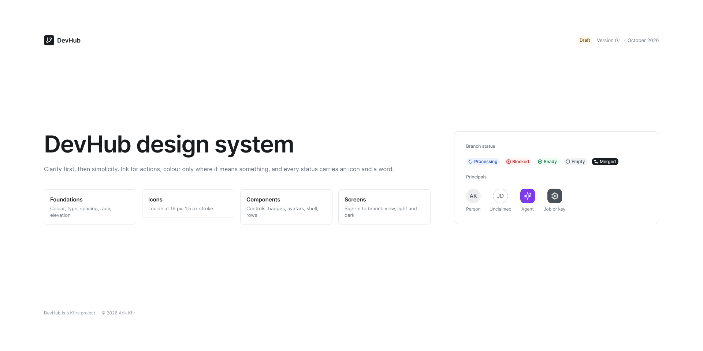

| Figma page | Holds |
| --- | --- |
| Cover | Title, status, a sample of the language, credit |
| Foundations | Principles, colour in light and dark, type scale, spacing, radii, elevation, layout |
| Icons | 70 Lucide icons as components |
| Components | Controls, badges, avatars, menus, tables, app shell, list-row patterns, brand |
| Screens | Sign-in, sign-up, organization home, members, repository, issue, branch (light and dark) |

## Principles

Six rules decide every screen; when a design breaks one, the design changes, not the rule.

1. **Ink, not colour, for the interface.** Chrome, text and the primary action are near-black on white (inverted in
   dark mode). Colour is reserved for meaning, so it stands out when it appears.
2. **Status is an icon, a word and a colour.** Never colour alone: a badge reads correctly in grayscale, to colour-blind
   users and in a screen reader.
3. **Violet means AI.** Agents, AI reviews and agent work use violet and the sparkles icon, and nothing else does. A
   person can always tell what a machine did.
4. **Shape tells who acted.** People are circles; agents, jobs, keys and apps are rounded squares; a commit author not
   yet linked to a user is a dashed circle.
5. **One primary action per view.** It is the only ink-filled button on screen ("Merge", "New repository"); everything
   else is secondary or ghost.
6. **Code is mono, prose is sans.** Branch names, SHAs, paths and environments use JetBrains Mono; everything people
   wrote uses Inter.

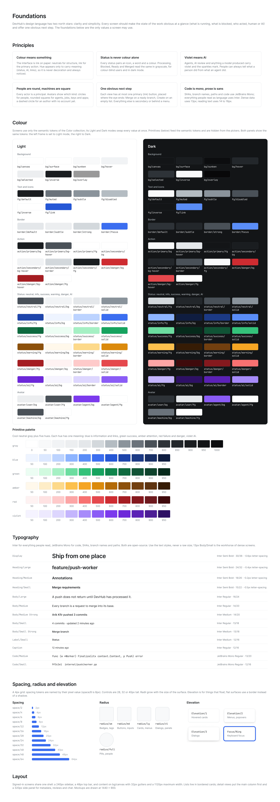

## How it fits together

**Two layers of colour, components from tokens only, screens from instances only**


A token changes in Figma first, then in `tokens.css`, in the same pull request. A fix to a component reaches every
screen.

## Colour

Colour has two layers: primitives hold raw values, and semantic tokens alias them per mode. Components use semantic
tokens only, and Light and Dark are two modes of the one `Color` collection, so a frame changes theme by switching its
mode.

**Primitives** (`Primitives`): a cool gray in 15 steps, from `gray/0` #ffffff to `gray/1000` #0c0d0f; blue, green,
amber, red and violet in 11 steps each (50 to 950); and black at 6, 10, 12, 40, 50 and 60% for overlays and shadows.

**Semantic tokens** (`Color`):

| Token | Light | Dark | Use |
| --- | --- | --- | --- |
| `bg/canvas` | gray/0 | gray/950 | Page background |
| `bg/surface` | gray/0 | gray/900 | Cards, panels, inputs |
| `bg/sunken` | gray/50 | gray/1000 | Code chips, wells |
| `bg/hover` | gray/100 | gray/850 | Hovered rows and ghost buttons |
| `bg/selected` | gray/150 | gray/800 | Selected nav item or row |
| `bg/inverse` | gray/900 | gray/50 | Merged badge, tooltips |
| `bg/overlay` | black 40% | black 60% | Behind dialogs |
| `fg/default` | gray/900 | gray/50 | Text and icons |
| `fg/muted` | gray/600 | gray/400 | Secondary text, metadata |
| `fg/subtle` | gray/500 | gray/500 | Placeholders |
| `fg/disabled` | gray/400 | gray/700 | Disabled controls |
| `fg/inverse` | gray/0 | gray/950 | Text on `bg/inverse` |
| `fg/link` | blue/600 | blue/400 | Links |
| `border/default` | gray/200 | gray/800 | Cards and controls |
| `border/subtle` | gray/150 | gray/850 | Dividers between rows |
| `border/strong` | gray/300 | gray/700 | Inputs, the composer |
| `border/focus` | blue/500 | blue/400 | Focus ring |
| `action/primary/bg`, `bg-hover`, `fg` | gray/900, gray/700, gray/0 | gray/50, gray/200, gray/950 | The one primary button |
| `action/secondary/bg`, `bg-hover`, `border`, `fg` | gray/0, gray/100, gray/300, gray/900 | gray/900, gray/850, gray/700, gray/50 | Secondary buttons |
| `action/danger/bg`, `bg-hover`, `fg` | red/600, red/700, gray/0 | red/600, red/500, gray/0 | Destructive confirmations |
| `avatar/user/bg`, `fg` | gray/150, gray/700 | gray/800, gray/200 | People |
| `avatar/agent/bg`, `fg` | violet/600, gray/0 | violet/500, gray/0 | Agents |
| `avatar/machine/bg`, `fg` | gray/700, gray/0 | gray/600, gray/0 | Jobs, keys, apps |
| `shadow/soft`, `shadow/strong` | black 6%, 12% | black 40%, 60% | Elevation |

**Status tones** (`status/<tone>/fg`, `bg`, `border`, `solid`): Light uses steps 700, 50, 200 and 500 of the tone's hue;
Dark uses 300, 950, 800 and 400. Neutral differs slightly: its `bg` is gray/100 in light and gray/850 in dark, its dark
`border` gray/700 and its dark `solid` gray/500.

| Tone | Hue | Means |
| --- | --- | --- |
| `neutral` | gray | No state yet, empty, paused, optional |
| `info` | blue | In progress, processing, syncing |
| `success` | green | Passed, approved, ready, synced |
| `warning` | amber | Needs a person: changes requested, draft |
| `danger` | red | Failed, blocked |
| `ai` | violet | Made by or about an agent |

Contrast: body and metadata text pass WCAG AA in both modes (`fg/muted` 4.8:1 light, 8.8:1 dark), and every status `fg`
on its `bg` is at least 6:1. `fg/subtle` is 3.1:1 in light, so it holds placeholders only, never information.

## Typography

Two families and 14 text styles cover every screen: Inter for prose and interface, JetBrains Mono for anything that is
code. Both are open-source (SIL Open Font License). Body text is 13 to 14 px, dense enough for lists of branches and
commits and still easy to read.

| Style | Font | Size / line height (px) | Use |
| --- | --- | --- | --- |
| Display | Inter Semi Bold | 30 / 36, -0.6 px | Sign-in and empty states |
| Heading/Large | Inter Semi Bold | 24 / 32, -0.4 px | Page titles |
| Heading/Medium | Inter Semi Bold | 18 / 26, -0.2 px | Dialog titles |
| Heading/Small | Inter Semi Bold | 15 / 22, -0.1 px | Card titles |
| Body/Large | Inter Regular | 16 / 24 | Lead paragraphs |
| Body/Medium | Inter Regular | 14 / 20 | Descriptions, issue text |
| Body/Medium Strong | Inter Medium | 14 / 20 | Emphasis, callout titles |
| Body/Small | Inter Regular | 13 / 18 | Rows, metadata, chat |
| Body/Small Strong | Inter Medium | 13 / 18 | Names in rows |
| Label/Small | Inter Medium | 12 / 16 | Form labels, section labels |
| Caption | Inter Regular | 12 / 16 | Timestamps, counts |
| Code/Large | JetBrains Mono Medium | 20 / 28 | Branch name as a page title |
| Code/Medium | JetBrains Mono Regular | 13 / 20 | Branch names in rows, code blocks |
| Code/Small | JetBrains Mono Regular | 12 / 16 | SHAs, issue keys, file paths, environments |

Weights stop at Semi Bold: hierarchy comes from size and colour (`fg/default` against `fg/muted`), not from bold text.

## Spacing, radii, elevation and layout

Spacing follows a 4 px grid with a 2 px half-step, and every padding, gap and radius in the file is bound to a token, so
a change to a token moves every screen.

| Group | Tokens (px) | Use |
| --- | --- | --- |
| `space/*` | 0, 2, 4, 6, 8, 12, 16, 20, 24, 32, 40, 48, 64 | 8 to 12 inside controls, 16 inside cards, 24 between page sections, 32 page margins |
| `size/control-*` | sm 28, md 32, lg 40 | Button and input heights |
| `size/icon-*` | sm 16, md 20 | Icons |
| `size/topbar`, `size/sidebar` | 48, 240 | App shell |
| `radius/*` | none 0, sm 4, md 6, lg 8, xl 12, full 999 | sm for tags and code chips; md for buttons, inputs and menu items; lg for cards, menus and machine avatars; xl for dialogs; full for people, status badges and counts |

**Elevation** is rare: content sits on flat cards with a 1 px border, and shadows mark only what floats above the page.

| Style | Shadow | Use |
| --- | --- | --- |
| Elevation/1 | 0 1 2 `shadow/soft` | Tooltips and toasts (not drawn yet) |
| Elevation/2 | Elevation/1 + 0 4 12 -2 `shadow/strong` | Menus, popovers |
| Elevation/3 | 0 2 6 `shadow/soft` + 0 12 32 -4 `shadow/strong` | Dialogs (not drawn yet) |
| Focus/Ring | 2 px `bg/canvas` + 4 px `border/focus` | Keyboard focus on any control |

**Layout**: a 240 px sidebar (organization switcher, search, navigation, pinned repositories, the signed-in person) and a
48 px top bar (breadcrumb, "Ask an agent", notifications). Content has 32 px margins; detail pages add a 320 px side
column for properties, and the branch view docks its 400 px chat on the right. Screens are designed at 1440 × 900.

**The app shell: sidebar, top bar, content and a side column**


## Iconography

Icons come from [Lucide](https://lucide.dev) (ISC licence), drawn at 16 px with a 1.5 px stroke and round joins, so they
match Inter's weight at 13 to 14 px. The file holds 70 of them as components named `icon/<lucide name>`; their stroke is
bound to `fg/default`, and an instance takes the colour of its context.

- An icon never stands alone for a state: it sits beside a word, or carries a tooltip when space is short (icon
  buttons).
- One icon, one meaning across the product. The fixed ones:

| Meaning | Icon |
| --- | --- |
| Branch, merge, commit | `git-branch`, `git-merge`, `git-commit-horizontal` |
| Repository | `folder-git-2` |
| Processing, in progress | `loader-circle` |
| Success, ready | `circle-check` |
| Failed | `circle-x` |
| Blocked | `octagon-alert` |
| Pending | `clock` |
| Empty | `circle-dashed` |
| Approved | `badge-check` |
| Changes requested | `circle-alert` |
| Agent, AI | `sparkles` |
| Job, key, app | `cog`, `key-round` |
| Chat | `message-square` |
| Delivery, environment | `rocket` |

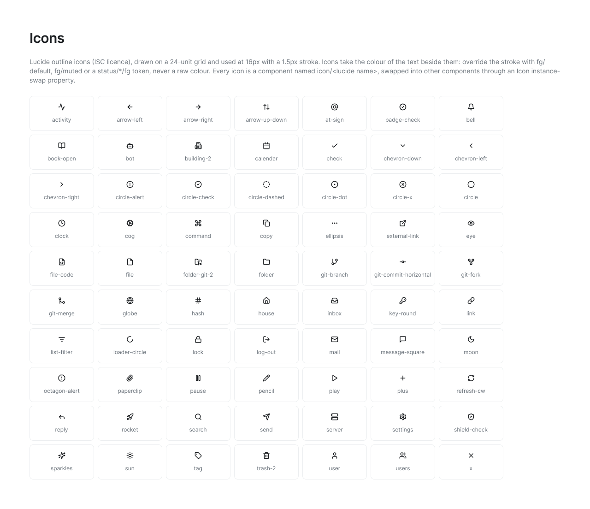

## Components

The Components page holds 25 components built only from the tokens above; screens are assembled from their instances,
so a fix to a component reaches every screen.

| Component | Variants | Properties |
| --- | --- | --- |
| Button | Style: Primary, Secondary, Ghost, Danger × Size: Medium 32, Small 28 × State: Default, Hover, Disabled | Label, leading icon, trailing icon (each optional, swappable) |
| Icon button | Style: Secondary, Ghost × Size | Icon |
| Input | State: Default, Focus, Error, Disabled | Label, value, helper text, leading icon (each optional) |
| Tab | State: Default, Selected | Label, icon, count |
| Menu, Menu item | Item: Tone Default, Danger × State Default, Hover, Disabled | Label, icon, shortcut, checked |
| Nav item | State: Default, Hover, Selected | Label, icon, count |
| Table header cell, Table cell | Cell kind: Text, Muted, Mono | Text |
| Badge/Branch status | Processing, Blocked, Empty, Merged, Ready | None: the status sets icon, word and tone |
| Badge/Annotation | Pending, In progress, Failed, Successful | None |
| Badge/Review | Approved, Changes requested, Neutral | None |
| Tag | Tone: Neutral, Info, Success, Warning, Danger, AI | Label, icon |
| Avatar | Kind: User, Unclaimed, Agent, Machine × Size: 20, 24, 32, 40 | Initials (people), glyph (machines) |
| App/Sidebar, App/Top bar | None | Organization, user; breadcrumb context and current page |
| Commit row | None | Message, meta, SHA; author avatar and annotation icons nested |
| Annotation row | Status (as Badge/Annotation) | Name, description, duration; creator avatar nested |
| Branch row | None | Name, meta, message count; status badge and author avatar nested |
| Chat message | Author: Person, Agent | Name, time, body, code reference |
| Repository row, Issue row, Member row | None | Name or title, description or email, meta; tags, avatars and role nested |
| Brand/Logo, Brand/Credit | None | None |

Two rules keep instances honest: never detach one to change it (add a property to the component instead), and never
place a node inside an instance (Figma refuses it; compose rows beside it).

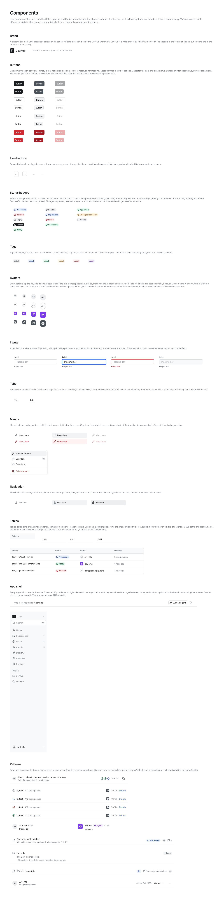

## Status language

Cobranch has three status vocabularies, one per object, and each word maps to exactly one icon and one tone everywhere it
appears: badges, rows, the branch view's requirements and the commit row's annotation icons.

| Object | Status | Icon | Tone |
| --- | --- | --- | --- |
| Branch | Processing | `loader-circle` | info |
| Branch | Blocked | `octagon-alert` | danger |
| Branch | Ready | `circle-check` | success |
| Branch | Empty | `circle-dashed` | neutral |
| Branch | Merged | `git-merge` | inverse (ink) |
| Annotation | Pending | `clock` | neutral |
| Annotation | In progress | `loader-circle` | info |
| Annotation | Failed | `circle-x` | danger |
| Annotation | Successful | `circle-check` | success |
| Review | Approved | `badge-check` | success |
| Review | Changes requested | `circle-alert` | warning |
| Review | Neutral | `message-square` | neutral |

Merged is ink rather than a colour: it is final, not a state anyone has to act on. A review that requests changes blocks
its branch, so the branch reads Blocked (danger) while the review itself reads Changes requested (warning). A blocked
branch always says why in the first line of its view, then lists each merge requirement with its own icon, so nobody
has to open the annotations to find the cause.

**A review that requests changes blocks its branch, and the branch says why**


How a branch's status is computed is the [product design's](product.md#branches).

## Principals and avatars

Every actor in Cobranch is a principal, and its avatar's shape and colour say what kind it is before its name is read.

| Kind | Shape | Fill | Content | Example |
| --- | --- | --- | --- | --- |
| User | Circle | `avatar/user` (light gray) | Initials | Arik Kfir, AK |
| Unclaimed | Dashed circle | None, `fg/subtle` outline | Initials from the commit | A commit author whose email no user has claimed |
| Agent | Rounded square (`radius/lg`) | `avatar/agent` (violet) | `sparkles` | Builder, Reviewer |
| Machine | Rounded square | `avatar/machine` (dark gray) | `cog`, or `key-round` for a key | Jobs, deploy keys, apps |

Sizes are 20 (inline in text and properties), 24 (reviews, participants), 32 (chat, members) and 40 (cover, profile).
Agents also carry an AI tag ("Agent", with `sparkles`) next to their name in chat and reviews, so the shape is never the
only cue.

## Screens

Eight mockups on the Screens page cover the core flows, all at 1440 × 900 and built only from library instances. They
follow one story: Kfirs works on `cobranch`, where Builder (an agent) implements DEV-42 on `feature/push-worker` and
Reviewer (an agent) blocks it.

| Screen | Shows |
| --- | --- |
| [Sign in](https://www.figma.com/design/ZJVoycorwQStSjh89hnSrK/Cobranch?node-id=12-2) | Google, GitHub and SSO, or email; link to sign up |
| [Sign up: organization](https://www.figma.com/design/ZJVoycorwQStSjh89hnSrK/Cobranch?node-id=12-79) | Step 2 of 2: create an organization (name, address) or ask to join one |
| [Organization home](https://www.figma.com/design/ZJVoycorwQStSjh89hnSrK/Cobranch?node-id=13-60) | Branches that need you, repositories, agents at work, recent activity |
| [Organization members](https://www.figma.com/design/ZJVoycorwQStSjh89hnSrK/Cobranch?node-id=13-554) | A request to join, members with roles, invited people |
| [Repository](https://www.figma.com/design/ZJVoycorwQStSjh89hnSrK/Cobranch?node-id=15-646) | Branches by status (no pull requests), merge requirements, environments |
| [Issue](https://www.figma.com/design/ZJVoycorwQStSjh89hnSrK/Cobranch?node-id=15-1127) | Description, linked branch, activity with people and agents, properties, "Assign to an agent" |
| [Branch](https://www.figma.com/design/ZJVoycorwQStSjh89hnSrK/Cobranch?node-id=18-1149) | Why it is blocked, merge requirements, commits with annotation icons, annotations, reviews, branch chat with agents |
| [Branch, dark](https://www.figma.com/design/ZJVoycorwQStSjh89hnSrK/Cobranch?node-id=19-1864) | The same frame in the Dark mode, unchanged otherwise |

Not drawn yet: files and diffs, jobs, delivery and environments, settings, agent management, dialogs, and empty and
error states.

### Sign in

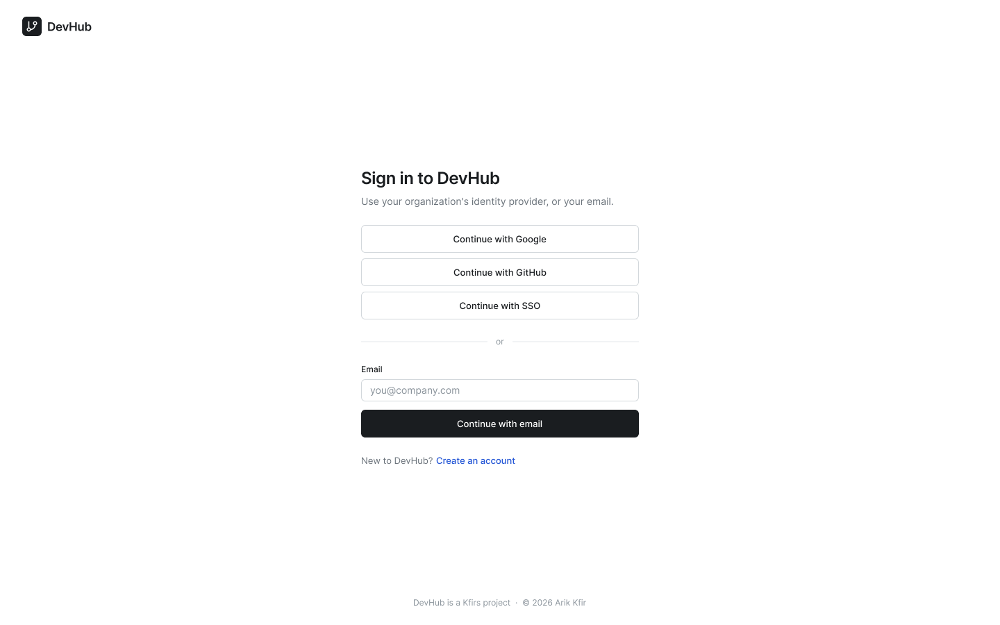

### Sign up: organization

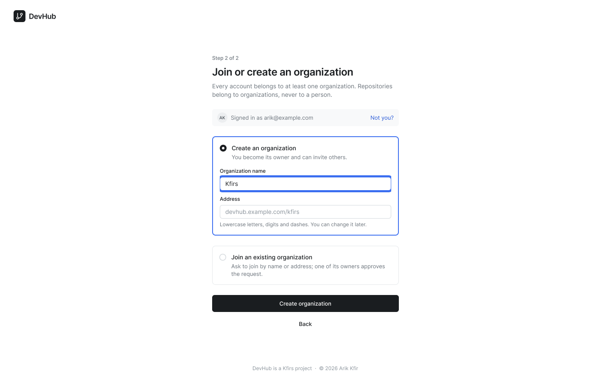

### Organization home

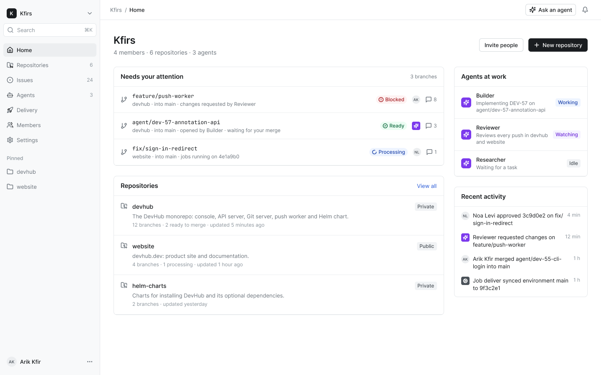

### Organization members

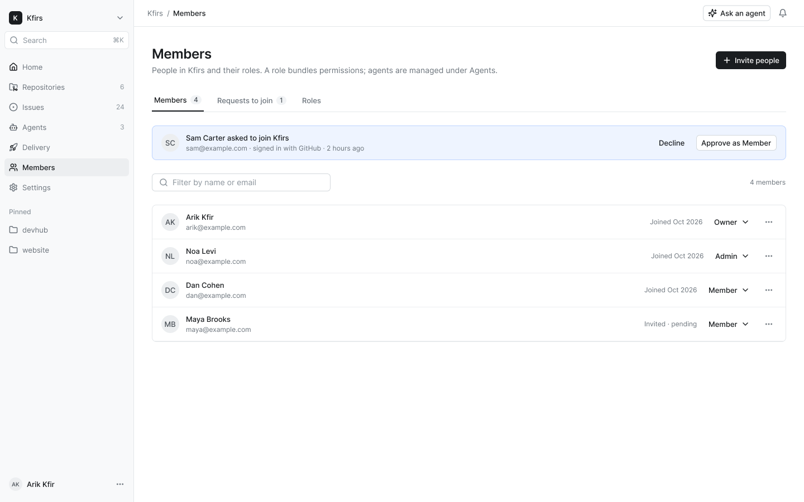

### Repository

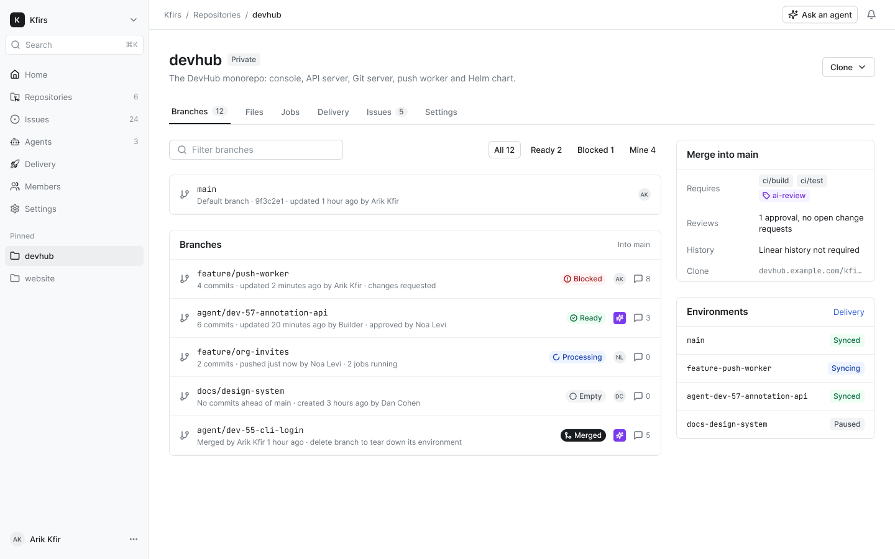

### Issue

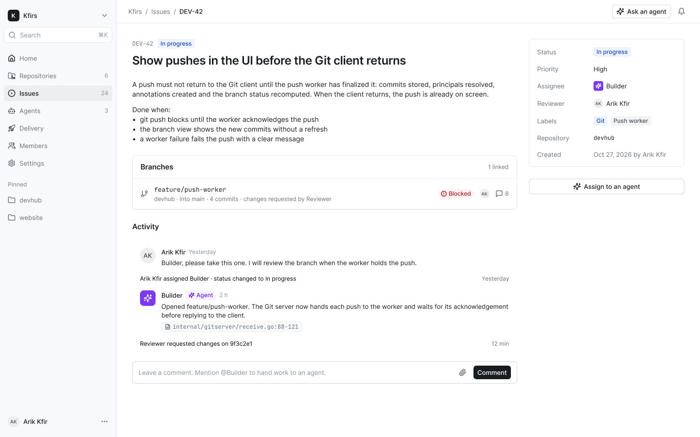

### Branch

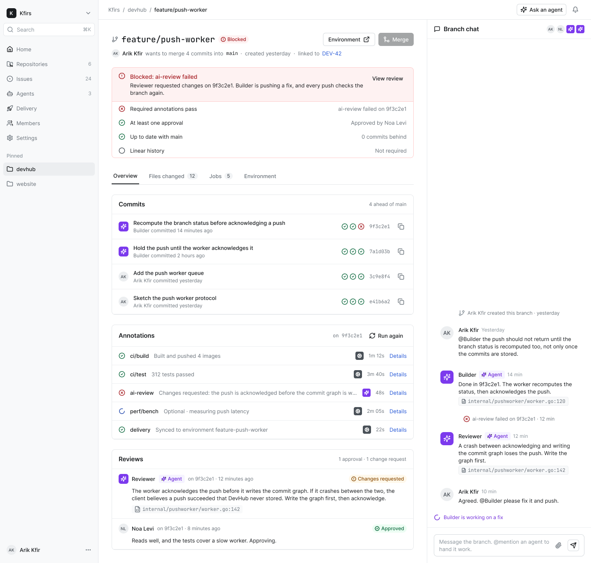

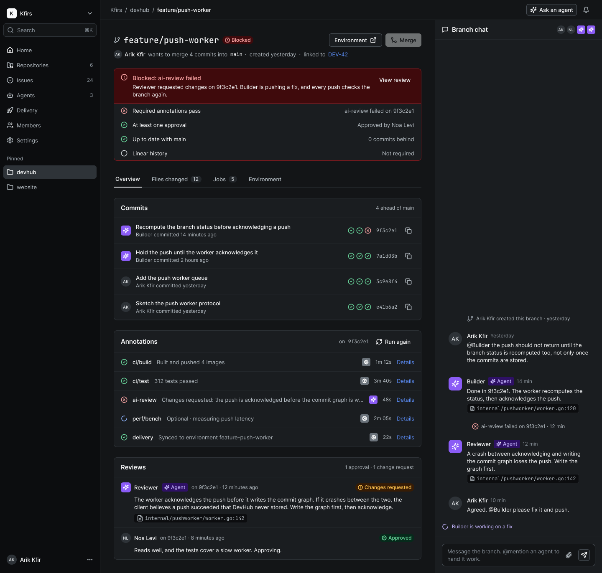

## From design to code

Every Figma variable carries its CSS name, and [`design-system/tokens.css`](design-system/tokens.css) holds them all:
semantic colours are `--color-*` custom properties (`bg/canvas` is `var(--color-bg-canvas)`), and spacing, radii and
primitives keep their own prefixes (`var(--space-16)`, `var(--radius-lg)`, `var(--gray-900)`). Light applies by default;
dark applies with `data-theme="dark"` on the root element, or with the system's dark preference unless
`data-theme="light"`. The console imports these tokens rather than hard-coding a value, and a token changes in Figma
first, then here, in the same pull request.

**From a Figma variable to a CSS custom property to the Console**


```css
.card {
  background: var(--color-bg-surface);
  border: 1px solid var(--color-border-default);
  border-radius: var(--radius-lg);
  padding: var(--space-16);
}
```

## Decisions

| Question | Decision |
| --- | --- |
| Is violet right for AI, or should agents share the interface's ink? | Violet, for agents and AI work only (2026-10-27) |
| Should a branch with changes requested be Blocked, or a softer state of its own? | Blocked (2026-10-27) |
| Is Inter the face, or does Cobranch need a typeface of its own for the logo and headings? | Inter for now (2026-10-27) |
