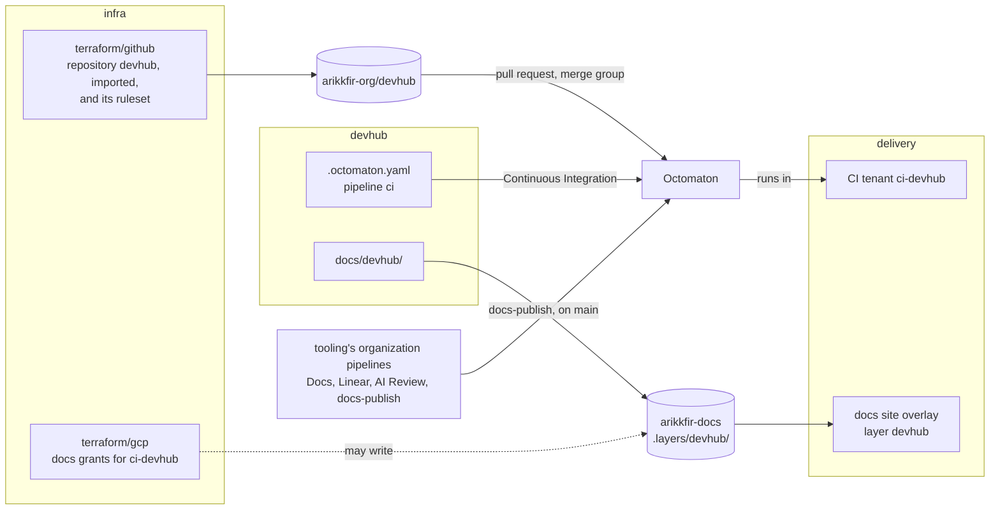

# The DevHub repository

**Decision**: DevHub lives in one repository, `arikkfir-org/devhub`: one Go module, one binary, the web apps, the Helm chart, the SDKs and the design documents side by side, so a change to DevHub is one pull request however many parts it touches. It is a repository of the organization like any other: `infra` manages it with the organization's settings and ruleset, `delivery` gives it a CI tenant, Octomaton runs its CI, and its `docs/` reaches the hub's docs site. It is public, under the MIT License.

## Context and goal

DevHub is a product of its own, not part of the Kfirs hub: anyone installs it on their own Kubernetes cluster with one Helm chart (the [DevHub design](https://claude.ai/artifact/ToveH8gtEXkiJcN8KDtxaa), and its [technical architecture](architecture.md)). Its source still needs a home where its work is reviewed, built and documented, and the hub already provides one to every repository of the organization: pull requests through a merge queue, CI through Octomaton, an AI review, Linear's check, and a docs site. The goal of [ENG-192](https://linear.app/arikkfir/issue/ENG-192) is a repository that gets all of that from its first pull request, with a layout that every later slice fills in rather than reshapes.

## Layout

| Path | Holds |
| --- | --- |
| `cmd/devhub/` | The one binary, with a subcommand per workload. Today only `version`, which prints the version the binary was built as |
| `internal/` | The Go packages, in three layers: `services/` (the domain), `adapters/` (transports, storage, outside systems) and `system/` (configuration, telemetry, build information). Today only `system/buildinfo` |
| `web/`, `api/`, `db/migrations/`, `sdk/`, `chart/devhub/` | Planned: the web apps, the API contracts, the migrations, the SDKs and the Helm chart, each with the slice that first needs it |
| `docs/devhub/` | DevHub's pages on the docs site, `devhub/`: its designs in `designs/` |
| `.octomaton.yaml`, `.tekton/` | CI |
| `.golangci.yml` | The linters every Go change passes |

The README keeps the full table as the layout grows; the [technical architecture](architecture.md#stack-and-repository-layout) agreed the paths still planned.

## Continuous integration

Pipeline `ci` (check `Continuous Integration`) runs on every pull request, whatever its base, and on every merge queue group. Its one task checks the commit out and then runs, in one pod:

| Step | Image | Runs |
| --- | --- | --- |
| `clone` | `alpine/git` | Fetches the commit, anonymously: the repository is public |
| `lint` | `golangci/golangci-lint` | `golangci-lint run ./...`: golangci-lint's standard linters and the house rules' (errcheck, wrapcheck, contextcheck, sloglint, spancheck, depguard, funlen, gocognit, revive with `use-any`), and gofmt |
| `vet` | `golang` | `go vet ./...` |
| `test` | `golang` | `go test -race -count=1 ./...` |
| `build` | `golang` | `go build -trimpath ./cmd/...`, static |
| `version` | `golang` | `devhub version`, the binary just built |

Every image is pinned to a version. The steps share Go's build, module and lint caches in an `emptyDir`, so `test` reuses what `vet` compiled; nothing is cached between runs yet. The task requests 500m of CPU and 512Mi of memory, with a 1Gi limit: the skeleton's lint and race tests run within 512Mi.

The organization's pipelines, read from `tooling`, run beside it: check `Docs`, which composes `docs/devhub/` with the other repositories' layers and fails on broken links, and `docs-publish` on every push to `main` ([docs site composition](../../hub/designs/docs-site-composition.md)); check `Linear` ([check Linear](../../tooling/designs/linear-check.md)); and the AI review, on request ([pull request reviewer](../../tooling/designs/pr-reviewer.md)). The `Default branch` ruleset requires `Continuous Integration`, `Docs` and `Linear` from Octomaton before a pull request enters the merge queue ([root github](../../infra/terraform/github.md)).

## Decisions

| Decision | Why | Rejected |
| --- | --- | --- |
| One repository for every part of DevHub | A change across the API, the web apps, the chart and the docs is one reviewed pull request, tested and released at one version | A repository per component, whose versions would have to be matched |
| One Go module at the root, `github.com/arikkfir-org/devhub` | One `go.mod` for every Go package and one version of each dependency; no domain is chosen yet for a vanity path | A module per workload; a vanity path before a domain exists |
| One binary, a subcommand per workload | Every workload runs the same build at one version, and the chart picks the subcommand | A binary per workload |
| Created by hand, then imported by `infra` | The owner created it with its license and pushed its first designs straight to `main`; importing it gives it the organization's settings and ruleset from then on, and every later change comes through a pull request | Waiting for `infra` to create it before anything could be pushed |
| Public, under the MIT License | The owner's choice: DevHub is a product anyone may install, and its source is open with it | Internal until a license was chosen |
| An anonymous clone | A public repository needs no token, so the run holds none | Octomaton's installation token, which only a private or internal repository needs |
| golangci-lint from the first commit | The house rules' linters hold from the first line of code, instead of a cleanup once the code base exists | Adding them later |
| No persistent Go cache yet | A skeleton with no dependencies builds in seconds; a cache needs a bucket and an identity of its own | Octomaton's bucket-backed caches, worth it once builds are slow |

## Security and failure modes

- Any branch's pull request runs its own `.octomaton.yaml` and `.tekton/` as the tenant's ServiceAccount `pipeline`, which holds no Google Cloud role, and with no GitHub token. Octomaton ignores forks, so a stranger's pull request runs nothing.
- Until `ci-devhub` exists, Octomaton refuses every pipeline on the repository and its pull requests can't pass the required checks; until `infra`'s grants apply, check `Docs` fails for want of its roles.
- A missing check blocks the merge queue, never merges unchecked; the admin bypass remains the owner's.

## Rollout

1. The owner creates the repository by hand, with its license, and the first designs go straight to `main`, as does this page with the README, `CLAUDE.md`, the Go skeleton and CI.
2. `infra` imports the repository and grants its CI tenant's docs roles ([arikkfir-org/infra#90](https://github.com/arikkfir-org/infra/pull/90)): from its apply, the ruleset admits changes only through pull requests.
3. `delivery` creates the CI tenant `ci-devhub` and adds the repository's layer to the docs site ([arikkfir-org/delivery#86](https://github.com/arikkfir-org/delivery/pull/86)). The next push to `main` publishes `docs/devhub/`, and every pull request gets its checks.

## Open questions

- **Module path.** A vanity path, as Octomaton's `octomaton.dev`, waits for a domain.
- **CI for the rest.** The web apps, the chart and the SDKs bring their own CI steps with them: [ENG-195](https://linear.app/arikkfir/issue/ENG-195) installs the chart on a throwaway cluster.
