# The Console's design tokens

The Figma file of Cobranch's design system ([design](../../../docs/cobranch/designs/design-system.md)) is the source of every colour, size, radius, text style and shadow the Console draws with. They reach the Console in one direction, by export:

```mermaid
flowchart LR
  F[Figma file<br/>variables, text and effect styles] -->|figma-export.js<br/>run in the file| J[tokens.json]
  J -->|go generate<br/>tokens/| C[public/assets/tokens.css]
  C --> P[console.css, components, pages<br/>var&#40;--color-…&#41;, var&#40;--text-…&#41;]
```

| File | What it is |
|---|---|
| `figma-export.js` | A Figma Plugin API script that reads the file's local variables, text styles and effect styles and returns them as JSON. It only reads. |
| `tokens.json` | Its output, committed as the record of what the Console was last generated from. |
| `tokens/` | The generator: `go generate ./web/console/tools/...` writes `public/assets/tokens.css` from `tokens.json`. CI's generated-code check fails when they differ. |

## Changing a token

1. Change the variable or style in Figma. Every variable carries its CSS name in its `codeSyntax` (Web), which the export uses, so names never drift; a new variable needs one.
2. Run `figma-export.js` in the file: through an agent's Figma tool (`use_figma`), or pasted into a development plugin's code. Save what it returns, formatted (`jq .`), as `tokens.json`.
3. Run `go generate ./web/console/tools/...` and commit `tokens.json` and `tokens.css` together. The pull request names the Figma change it carries.

## What the export carries

| Figma | CSS |
|---|---|
| A variable | `--<codeSyntax>`: a colour, `px` for a number, or `var(--…)` for an alias. A collection's first mode is the default (light); its `Dark` mode applies under the system's dark preference unless `data-theme="light"` is on `<html>`, and always under `data-theme="dark"`. |
| A text style, such as `Body/Small Strong` | `--text-body-small-strong`, a `font` shorthand (`500 13px/18px var(--font-sans)`), and `--text-body-small-strong-tracking`, its `letter-spacing`. `Code/*` styles are in `--font-mono`, the others in `--font-sans`. |
| An effect style, such as `Focus/Ring` | `--shadow-focus-ring`, a `box-shadow` whose colours are the variables they're bound to, so it follows the theme. |

The typefaces themselves, Inter and JetBrains Mono, are served with the Console (`public/assets/fonts.css`).
